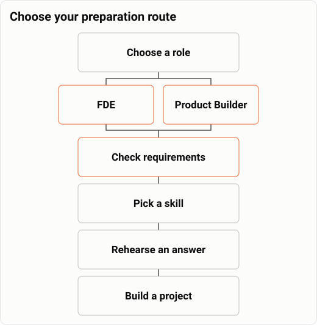

# Careers ahead

[English](README.md) · [Русский](../ru/careers/README.md) · [Atlas map](../README.md)

Understand what a role asks you to do, then choose what to practise. This guide connects market signals with public role descriptions, skills and work you can demonstrate. It complements the Atlas question bank.

## Your reading route

<picture>
  <source media="(prefers-color-scheme: dark)" srcset="../assets/careers-route.en.dark.svg">
  
</picture>

| Your question | Where to go |
| --- | --- |
| Why pay attention to these roles? | [Market snapshot](#market) |
| What do employers require? | [FDE requirements](fde.md#role-requirements) · [Product Builder](product-builder.md) |
| What should I learn next? | [Skills K1–K8](fde.md#skills) |
| What should I practise? | [Interview evidence](fde.md#interview-prep) · [Projects](fde.md#projects) |
| How do I organise preparation? | [Two-week plan](fde.md#two-week-preparation-plan) |
| What has been reported about FDE interviews? | [Sourced role guide](../roles/fde.md) |
| Which other AI roles should I compare? | [AI role families](../AI_ROLES.md) |

The [Atlas map](../README.md) offers routes by profession, vacancy and interview. The [project roadmap](../ROADMAP.md) describes repository development, not your study schedule.

## What is changing in the tech job market

[Detailed market review: datasets, periods and limits](market.md).

Lenny Rachitsky's **10 November 2026** report describes stronger PM openings, slowing engineering demand and weaker design hiring, alongside broader demand for AI skills. Its datasets measure different things: TrueUp tracks global openings at tech companies; Live Data Technologies supplies US hiring data. Openings and completed hires are not interchangeable. [Public excerpt](https://www.lennysnewsletter.com/p/state-of-the-tech-job-market-late).

One narrower signal is **4.6× growth in FDE openings over the preceding year, to roughly 1,500**. The author notes that renaming adjacent roles may contribute. This is a dated observation, not evidence of easy entry or low competition. [FDE discussion](https://www.lennysnewsletter.com/p/state-of-the-tech-job-market-late).

## Two roles to examine

| Role | What to inspect | Guide |
| --- | --- | --- |
| **Forward Deployed Engineer** | Code, customer systems, AI quality and delivery ownership | [Requirements → skills → interviews → projects](fde.md) |
| **Product Builder** | Design, working prototypes, production changes and continued use | [Two employer examples and one exercise](product-builder.md) |

These examples sit within a wider field. Compare the [six AI role families](../AI_ROLES.md), then use [AI Engineering](../start/engineering.md) or [AI Leadership](../start/leadership.md) for broader preparation.

## How to read the evidence

**Job descriptions** establish responsibilities. **Participant accounts** describe one person's work or interview. **Salary reports** may be employer ranges or unverified individual offers. **Mock interviews and practice projects** here are editorial exercises. None can silently substitute for another.

The [career sources register](sources.md) records dates and limits. Questions elsewhere retain their [original evidence markers](../METHODOLOGY.md). Checked **20 November 2026** unless another date is stated.
