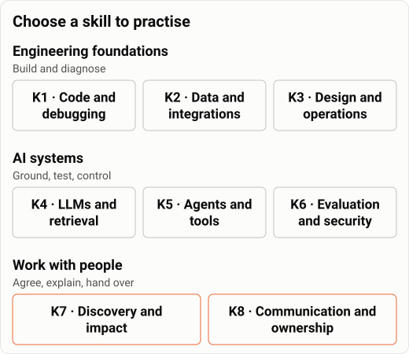
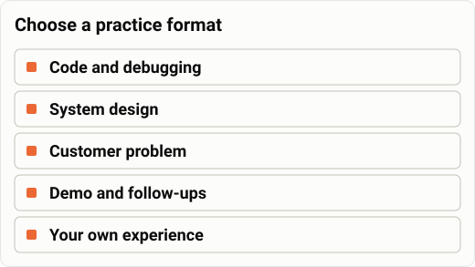
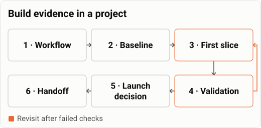

# Forward Deployed Engineer: from customer problem to production

[English](fde.md) · [Русский](../ru/careers/fde.md) · [Careers ahead](README.md) · [Atlas map](../README.md)

**Forward Deployed Engineer (FDE)** is a customer-facing engineering role that connects an unclear operational problem with a usable technical system. The title alone does not tell you how much coding, systems analysis, travel or commercial responsibility it contains. Start with the requirements, then test yourself against the work.

## <a id="role-requirements"></a>What FDE roles require

These are four concrete examples, not a universal checklist. Checked **20 November 2026**. The evidence-to-prepare column is our guidance, not an employer's interview rubric.

| Employer and exact role | Requirements in the description | Evidence to prepare |
| --- | --- | --- |
| [OpenAI — FDE, SF](https://openai.com/careers/forward-deployed-engineer-%28fde%29-sf-san-francisco/) | 5+ years in engineering or technical deployment including customer work; production frontend/backend code; LLM deployments. Travel up to 50%. | Explain and debug a working integration; defend a delivery decision. [K1](#k1), [K3](#k3), [K8](#k8) |
| [Anthropic — FDE, Munich](https://job-boards.greenhouse.io/anthropic/jobs/5391016008) | 8+ years in customer-facing technical work; Python, production LLMs, agents and evals; native German and fluent English. Travel 25–50%; enterprise-domain experience is a plus. | Show a tested agent and failure analysis; check language and location requirements before assuming fit. [K4](#k4)–[K6](#k6) |
| [LangChain — Deployed Architect, Professional Services](https://jobs.ashbyhq.com/LangChain/0a5dd30c-6da1-4095-bd96-b16f27eeb333) | A neighbouring title: customer work, production infrastructure, Kubernetes/IaC, agents, evaluation, Python or TypeScript. | Explain deployment boundaries and recovery as well as model behavior. [K3](#k3), [K5](#k5). Read via the indexed official page; direct retrieval returned a JavaScript shell. |
| [WMT — Системный аналитик AI/Data / FDE](https://dreamjob.ru/employers/107743/vakansii/138622411) | Archived mirror: 4+ years in analysis or related implementation work; SQL, API integration, process models and acceptance criteria. Python is a plus. | Produce an API contract, SQL checks and a traceable acceptance decision. [K2](#k2), [K7](#k7). [Russian example and limits](#russia-wmt) |

For your vacancy, make four columns: **requirement → what you must do personally → evidence you already have → what remains unverified**. Keep mandatory requirements separate from preferences. A study project can demonstrate a skill; it does not replace years of experience, language proficiency or work eligibility.

**Choose your next step:** [skills K1–K8](#skills) · [interview preparation](#interview-prep) · [practice cases](#practice-cases) · [projects](#projects).

## <a id="what-the-role-owns"></a>Three responsibility paths

Use these editorial paths to inspect a vacancy, not to rename it or assume an easier technical bar.

| Path | Work to demonstrate | Ask the employer |
| --- | --- | --- |
| **Hands-on engineering** | Code, tests, debugging, integration and production decisions | Who writes and reviews production code? Is there on-call? What coding is assessed? |
| **Integration and systems analysis** | Data models, SQL, API contracts, requirements and acceptance | Which parts do I implement personally? Who owns data quality? Is programming a main duty or a plus? |
| **Technical deployment leadership** | Technical trade-offs, scope, dependencies, launch decisions and handoff | Who owns architecture and code? What team and authority come with the role? Is there a revenue quota? |

Presales may focus on technical fit before purchase; core product engineering usually improves a shared product; FDE work often also deals with a customer's local constraints. Boundaries vary. Leadership experience does not establish production coding ability, and a working demo does not establish delivery ownership.

For a concrete technical-leadership comparison, [Anthropic's Staff FDE](https://job-boards.greenhouse.io/anthropic/jobs/5449229008) spans account-level technical direction, architecture across workstreams and hands-on delivery. It still expects strong programming and production-systems experience. This is a separate US role; do not transfer Munich's language or experience requirements to it.

## <a id="why-this-role-now"></a>Market context

The [dated market snapshot](README.md#market) explains why FDE attracts attention. Growth in a title does not identify which of the paths above a particular team needs. Compare the neighbouring [Product Builder role](product-builder.md) by responsibilities rather than by the novelty of its name.

## <a id="day-to-day"></a>What FDEs actually do

First-person accounts can expose questions that a job description leaves open. They are individual, unverified observations, not an average working week.

| Observation and source | What remains unknown | A useful employer question |
| --- | --- | --- |
| One [Reddit commenter](https://www.reddit.com/r/cscareerquestions/comments/1x86xpc/comment/phg9zdt/) describes meetings, architecture, POCs, connectors and eventually a quota. | Whether the target team is engineering-led, presales or a mixture | How is success measured, and how much time goes to building versus sales support? |
| Another [commenter](https://www.reddit.com/r/cscareerquestions/comments/1x86xpc/comment/phdls6g/) describes participation from architecture and integration through training and production. | The actual boundary of ongoing support | Who owns incidents and the customer handoff after launch? |
| [First Round's interviews with practitioners](https://review.firstround.com/so-you-want-to-hire-a-forward-deployed-engineer/) discuss turning customer discoveries into product improvements. | Whether this team has a route into the product roadmap | Can you describe a customer-specific solution that became a reusable product capability? |

Publication dates are recorded where available in the [source register](sources.md); relative Reddit age labels are not treated as exact dates.

## <a id="russia-wmt"></a>Russia: one archived WMT example

The [Dream Job copy](https://dreamjob.ru/employers/107743/vakansii/138622411) is labelled archived and dated 19 October 2026; the [Quick Offer copy](https://quick-offer.ru/job/sistemnyy-analitik-aidata-forward-deployed-engineer-fde-103906) is labelled closed. Treat them as mirrors of one role, not two independent confirmations or current hiring opportunities.

The scope combines process analysis, SQL, REST/webhooks and acceptance through implementation. It illustrates an integration-heavy variant; it does not establish that FDE roles generally require little coding. Quick Offer's AI assessments and suggested interview questions are platform content, not statements from WMT or reports of its interviews.

For historical Russian discussion, [Habr's “AI implementation engineer” article](https://habr.com/ru/articles/964392/) was published **8 November 2025**. It is commentary, not a current Russian market census or a substitute for employer requirements.

## <a id="compensation"></a>Compensation and offers: what to compare

These observations are not a salary benchmark. Separate base pay, bonus, equity and total compensation (TC); do not compare currencies or periods as if they were equivalent. Checked 20 November 2026.

| Evidence | Amount and scope | What it does not establish |
| --- | --- | --- |
| [OpenAI SF posting](https://openai.com/careers/forward-deployed-engineer-%28fde%29-sf-san-francisco/) — employer range | US$185k–300k annual base; equity additional | A particular offer, equity value or guaranteed bonus |
| [Reddit offer self-report](https://www.reddit.com/r/Salary/comments/1vbawdb/29m_just_accepted_dream_job_as_a_fde_at_tier_1_ai/) — unverified individual account | Author states US$552k TC for 2026, including US$230k base and pre-IPO equity | Employer identity, vesting terms, liquidity or realised payment; do not guess the company |
| [WMT on Quick Offer](https://quick-offer.ru/job/sistemnyy-analitik-aidata-forward-deployed-engineer-fde-103906) — archived mirror | From RUB220k; pay period and gross/net basis not established in the retrieved text | A current offer or reliable market median; omit the platform's AI-generated salary analysis |

Before comparing an offer, ask for the pay period, location, base, target versus guaranteed bonus, equity instrument, vesting and valuation basis. An estimated pre-IPO value is not cash available to spend.

## <a id="skills"></a>Skills K1–K8

This is an editorial preparation map, not an industry standard or a score of your readiness. Follow a row to a question, answer aloud, then produce the named artifact. Each linked question retains its own evidence marker.

<picture>
  <source media="(prefers-color-scheme: dark)" srcset="../assets/fde-skills.en.dark.svg">
  
</picture>

| Area | What to produce and check | Practice question |
| --- | --- | --- |
| <a id="k1"></a>**K1 — Code, tests and debugging** | A reproducible change; explain the code and diagnose a failure | [Debug an API service](../themes/coding-practical.md#code-debug-api-service) |
| <a id="k2"></a>**K2 — Data and integrations** | An API contract and data checks; handle duplicates and missing values | [Reliable webhooks](../themes/ai-system-design.md#sd-webhooks) |
| <a id="k3"></a>**K3 — System design and operations** | Failure boundaries, service objectives, cost and recovery instructions | [An LLM gateway](../themes/ai-system-design.md#sd-gateway) |
| <a id="k4"></a>**K4 — LLMs and retrieval** | Separate retrieval failures from generation failures | [Enterprise retrieval](../themes/ai-system-design.md#sd-enterprise-rag) |
| <a id="k5"></a>**K5 — Agents and tools** | Justify autonomy; reconcile an unknown external outcome | [Tool retries](../themes/agents-tools.md#agt-retries) |
| <a id="k6"></a>**K6 — Quality and safety** | Representative tests, a release gate, permissions and bound approval | [Release gate](../themes/evals-observability.md#eval-release-gate) · [Approval](../themes/agents-tools.md#agt-approval) |
| <a id="k7"></a>**K7 — Problem and impact** | Current workflow, baseline and a reason to use AI | [Discovery](../themes/applied-scenarios.md#app-claims-discovery) |
| <a id="k8"></a>**K8 — Communication and ownership** | An understandable decision, named owners and handoff | [Launch readiness](../themes/program-delivery.md#prog-multi-owner-readiness) |

An engineer should demonstrate working code. An integration specialist should show contracts, SQL and acceptance checks. A deployment leader should explain technical trade-offs and decision authority, identifying precisely which engineering work was theirs. All three need enough understanding to recognise failures outside their strongest area.

## <a id="interview-prep"></a>Interviews: evidence and practice

**[Worked answers to reported FDE questions](fde-forum-answers.md)** — 12 detailed walkthroughs with code, reasoning, follow-ups and checks. Use the [forum reports](fde-forum-reports.md) to see which parts participants actually described.

Prepare in this order: check the target team's process, select relevant reported questions, rehearse a mock, then fix a demonstrated gap. Coding requirements vary; neither AI tools nor customer-facing work make coding fundamentals disappear.

<picture>
  <source media="(prefers-color-scheme: dark)" srcset="../assets/fde-interviews.en.dark.svg">
  
</picture>

| Origin | Concrete material | How to use it |
| --- | --- | --- |
| **Interviewer account** | In [First Round](https://review.firstround.com/so-you-want-to-hire-a-forward-deployed-engineer/), a former Palantir FDE recruiting lead describes an insider-trading decomposition scenario. [Atlas question](../themes/applied-scenarios.md#app-financial-crime-decomposition). | Explain which data and customer questions you need. This is historical firsthand hiring-side evidence, not a current universal loop. |
| **Candidate report** | A [Reddit FDSE account](https://www.reddit.com/r/csMajors/comments/1j99s3z/palantir_fdse_interview_experience_rejection/) describes designing an interest-sharing application and implementing a search function afterward. | Practise clarifying functionality before discussing scale. One unverified account does not establish every team's interview. |
| **Secondary preparation guide †** | [Catalogue search callable as a tool](../themes/coding-practical.md#code-catalogue-search-tool) is attributed to a guide on the canonical question page. | Practise the task; keep its secondary marker. Do not call it company-confirmed. |
| **Original mock** | A simulated customer wants “AI”, but cannot yet name the workflow or provide data. | Use the timed conversation below; no employer attribution. |
| **Original practice** | An ERP operation times out after it may have changed state. | Build and test [case 2](#case-2); this exercise is not a leaked interview task. |

**A 25-minute mock:** 5 minutes to identify the user, current task and constraints; 10 to propose a bounded pilot; 5 for the customer's objections; 5 for feedback. These times are our exercise format. The observer checks whether you ask before prescribing, define a measurable result, expose assumptions and agree an owner and next step. Repeat with a new constraint: data cannot leave the customer's environment.

For concrete questions from participants, read [FDE forum reports](fde-forum-reports.md): Reddit and LeetCode accounts, with dates, role scope and missing details kept visible. For more attributed stages and questions, use the [sourced FDE role guide](../roles/fde.md). Material indicating NDA restrictions is excluded under the [methodology](../METHODOLOGY.md).

## Practice cases

**Original exercises, not reported interview questions.** All quantities and deadlines below are synthetic constraints. Work through each aloud, then produce a one-page decision note. Related Atlas questions have their own provenance; linking them here does not establish that an FDE employer asks them.

### Case 1 — A useful support assistant in two weeks

**Brief.** A support team wants an assistant over 20,000 internal documents. Access differs by team, documents conflict, and reviewers have little spare time. The sponsor asks for a two-week pilot.

**Your task.** Ask five discovery questions, choose one workflow, draw the data path and propose a pilot decision. State what you would defer.

**A strong answer covers:** the existing task and time/error baseline; permissions enforced before evidence reaches the model; document freshness and citations; a representative evaluation set with answerable, unanswerable and forbidden-access cases; a human fallback; a named pilot owner. Separate retrieval failures from generation failures before changing models.

**A useful opening:** “I would pick one support workflow and agree what a correct, usable result means with its operators. Before expanding access, I would verify permissions and measure whether the assistant reduces work after review and correction.” Continue with architecture and tests; do not claim the exercise as past experience.

**Pressure test.** The demo looks good and the sponsor wants company-wide launch tomorrow. Name the missing evidence and propose the smallest safe next step.

Related: [enterprise retrieval design](../themes/ai-system-design.md#sd-enterprise-rag), [constrained enterprise pilot](../themes/applied-scenarios.md#app-vpc-pilot), [retrieval failures](../themes/applied-scenarios.md#app-rag-account-triage).

<a id="case-2"></a>

### Case 2 — The agent timed out after creating a work order

**Brief.** An assistant creates ERP work orders. A request times out, the operator retries, and two orders appear. The customer wants the model prompt fixed.

**Your task.** Explain the failure, sketch recovery and define what a human approves.

```text
Draft → Validate + authorise → Approve exact action → Execute
                                                       ↓
                                  Record outcome / reconcile timeout
                                                       ↓
                                    Retry only after state is known
```

**A strong answer covers:** unknown outcome versus failed operation; stable operation identifiers and downstream deduplication where available; reconciliation where it is not; approval bound to exact arguments and current permissions; audit records; compensation or escalation for irreversible effects. The executor enforces controls independently of model instructions.

**Pressure test.** The ERP has no idempotency API. Describe a lookup/reconciliation strategy and the remaining race. Explain when you stop automation for operator resolution instead of promising exactly-once execution.

Related: [ERP writes](../themes/agents-tools.md#agt-erp-writes), [timeouts and retries](../themes/agents-tools.md#agt-retries), [approval binding](../themes/agents-tools.md#agt-approval).

### Case 3 — The pilot passed its benchmark but nobody uses it

**Brief.** A pilot answers 90% of a small test set correctly. Weekly usage is declining, users still copy results into another tool, and the sponsor wants a rollout decision in five days.

**Your task.** Separate quality, workflow fit and adoption; propose an investigation and a decision with an owner.

**A strong answer covers:** test-set selection and hidden errors; observing actual users; total task time including review and re-entry; integration friction; relevant user segments; cost per completed useful task; criteria to continue, narrow or stop. Do not equate usage with benefit or a test score with production readiness.

**Pressure test.** One team loves the tool while another rejects it. Segment evidence instead of averaging away the difference.

Related: [rescuing a pilot](../themes/applied-scenarios.md#app-pilot-rescue), [AI suitability](../themes/ai-product-strategy.md#prod-ai-suitability), [AI feature metrics](../themes/ai-product-strategy.md#prod-ai-feature-metrics).

## Assess your answer

This editorial rubric diagnoses preparation gaps; it does not predict hiring. Score each dimension **0** when absent, **1** when named, **2** when connected to a concrete decision, artifact and trade-off.

| Dimension | What makes the answer inspectable |
| --- | --- |
| Discovery | User task, baseline, constraints and outcome owner |
| Engineering | Data flow, trust boundaries, integrations and recovery |
| Evaluation | Representative cases, failure analysis and justified release gate |
| Delivery | Scope, dependencies, staged exposure, rollback and handoff |
| Communication | Plain assumptions; decisions explained to operator and sponsor |

Rehearse any dimension below 2. A high total does not compensate for missing permissions or uncontrolled writes. Engineers should implement and test a narrow slice; leaders should explain architecture, delivery and accountability while being precise about their own contribution.

## <a id="projects"></a>Projects with completion criteria

Build with synthetic or appropriately licensed public data. These are original learning projects, not employer take-homes. Label simulated metrics explicitly; do not present a training result as real customer impact.

| Project | Deliverables | Failure to demonstrate | Completion check |
| --- | --- | --- | --- |
| **P1 — A document assistant for one task** | Brief, permission matrix, small corpus, evaluation set, runnable demo | Forbidden access, missing evidence, outdated document | Another person can reproduce the run; permissions hold; retrieval and generation errors are separated. K2, K4, K6, K7 |
| **P2 — A work-order agent with an API stub** | Contract, operation state, approval record, tests | Timeout after a write, duplicate request, expired approval | The system detects an unknown outcome and reconciles it; retries do not create uncontrolled duplicate effects. K1, K2, K5, K6 |
| **P3 — An operable pilot** | Baseline, rollout decision, runbook, owners and adoption slices | Good aggregate quality hides a failing user segment | A reviewer can trace a continue/narrow/stop decision to evidence and identify who supports the system. K3, K7, K8 |

### <a id="delivery-cycle"></a>Connect the work in the final project

<picture>
  <source media="(prefers-color-scheme: dark)" srcset="../assets/fde-project.en.dark.svg">
  
</picture>

| Stage | Artifact | Direct practice |
| --- | --- | --- |
| Discovery | Workflow, baseline and acceptance criteria | [First two weeks with a customer](../themes/applied-scenarios.md#app-claims-discovery) |
| Thin integration | One working path through data, API and permissions | [ERP writes](../themes/agents-tools.md#agt-erp-writes) |
| Quality and release | Failure cases and a justified launch gate | [Release gate](../themes/evals-observability.md#eval-release-gate) |
| Operate and hand off | Monitoring, recovery and a named owner | [Readiness across teams](../themes/program-delivery.md#prog-multi-owner-readiness) |
| Adoption and reuse | Useful-task outcomes and a reusable improvement | [Feature metrics](../themes/ai-product-strategy.md#prod-ai-feature-metrics) |

Present the result as a short demonstration, one difficult failure and one decision you changed after testing. For leadership preparation, add a decision note and responsibility map; identify who implemented each component. Neither a polished slide deck nor a demo without failure checks completes the exercise.

## Two-week preparation plan

| Sessions | Work | Completion evidence |
| --- | --- | --- |
| 1–2 | Compare two role descriptions; select a weak K-area | Requirement matrix and three recruiter questions |
| 3–4 | Case 1; K2, K4, K6, K7 | Workflow, architecture and evaluation table |
| 5–6 | Build P1; explain the code (K1) | Reproducible run, failures and limitations |
| 7–8 | Case 2 / P2; K1, K2, K5, K6 | Recovery tests and approval checklist |
| 9–10 | Case 3 / P3; K3, K7, K8 | Decision, owner, stop criteria and handoff |
| 11–14 | Two mocks; repeat a failed check | Improved second attempt and evidence of what changed |

Prepare one truthful example of ambiguity, one difficult failure and one handoff. Distinguish personal decisions from team achievements. If your example is a practice project, say so.

## <a id="sources-and-limits"></a>Further learning and source limits

- [Anthropic Partner Academy: Claude FDE](https://anthropic-partners.skilljar.com/path/claude-fde): the public outline lists 11 courses, about 9.5 hours; nine overlap Claude Developer, with Delivery Methodology and Driving enterprise adoption of Claude added. One outcome is a written pilot plan with a baseline, success measures agreed before building, a first shippable slice and initial users. This describes training, not interviews; check access conditions directly. Publication date not shown; checked 19 November 2026.
- [OpenAI FDE role](https://openai.com/careers/forward-deployed-engineer-%28fde%29-sf-san-francisco/): supports the responsibilities above; it does not verify coding-round format or interview questions.
- [Lenny's late-2026 report](https://www.lennysnewsletter.com/p/state-of-the-tech-job-market-late): supports the dated market signal. Only the publicly accessible excerpt was used.
- Continue with the [sourced FDE role guide](../roles/fde.md), [learning path](../LEARNING_PATH.md), [engineering](../start/engineering.md) and [leadership](../start/leadership.md) start pages. Confirm the actual interview format with the employer.

The [career sources register](sources.md) separates employer descriptions, practitioner accounts, salary evidence and editorial exercises, with dates and access limits.
