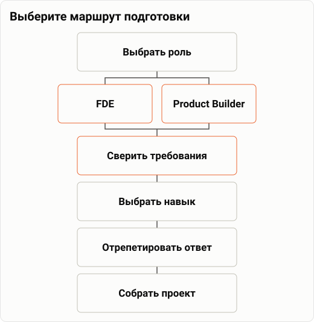

# Профессии будущего

[English](../../careers/README.md) · [Русский](README.md) · [Карта атласа](../README.md)

Сначала разберитесь, какой работы требует роль, затем выбирайте практику. Этот раздел связывает рыночные сигналы с публичными вакансиями, навыками и результатами, которые можно показать. Он дополняет банк вопросов атласа.

## Маршрут чтения

<picture>
  <source media="(prefers-color-scheme: dark)" srcset="../../assets/careers-route.ru.dark.svg">
  
</picture>

| Ваш вопрос | Куда перейти |
| --- | --- |
| Почему эти роли обсуждают? | [Рыночный срез](#market) |
| Что требуют работодатели? | [Требования FDE](fde.md#role-requirements) · [Product Builder](product-builder.md) |
| Что изучать дальше? | [Навыки K1–K8](fde.md#skills) |
| Что тренировать? | [Свидетельства об интервью](fde.md#interview-prep) · [Проекты](fde.md#projects) |
| Как организовать подготовку? | [Двухнедельный план](fde.md#two-week-preparation-plan) |
| Что известно об интервью на FDE из источников? | [Вопросы из рассказов на форумах](fde-forum-reports.md) · [Обзор роли](../roles/fde.md) |
| Как отвечать на вопросы из рассказов? | [12 подробных разборов с кодом и самопроверкой](fde-forum-answers.md) |
| С какими AI-профессиями сравнить? | [Направления работы в AI](../AI_ROLES.md) |

На [карте атласа](../README.md) можно выбрать вход через профессию, вакансию или интервью. [План развития проекта](../ROADMAP.md) описывает работу над репозиторием, а не расписание вашей подготовки.

## Что меняется на рынке IT

[Подробный разбор рынка: данные, периоды и ограничения](market.md).

Отчёт Ленни Рачицкого от **10 ноября 2026 года** описывает рост PM-вакансий, замедление инженерного спроса и ослабление найма дизайнеров при расширении требований к AI. TrueUp учитывает глобальные вакансии технологических компаний, Live Data Technologies — наймы в США. Открытая позиция и состоявшийся найм не взаимозаменяемы. [Публичный фрагмент](https://www.lennysnewsletter.com/p/state-of-the-tech-job-market-late).

Более узкий сигнал — **рост FDE-вакансий в 4,6 раза за предшествующий год, примерно до 1 500**. Автор допускает вклад переименования соседних ролей. Это датированное наблюдение, а не доказательство лёгкого входа или низкой конкуренции. [Разбор FDE](https://www.lennysnewsletter.com/p/state-of-the-tech-job-market-late).

## Две роли для изучения

| Роль | Что проверить | Руководство |
| --- | --- | --- |
| **Forward Deployed Engineer** | Код, системы заказчика, качество AI и ответственность за поставку | [Требования → навыки → интервью → проекты](fde.md) |
| **Product Builder** | Дизайн, работающий прототип, production-изменения и дальнейшее использование | [Два работодателя и одно упражнение](product-builder.md) |

Это примеры внутри более широкого поля. Сравните [шесть направлений работы в AI](../AI_ROLES.md), затем используйте стартовые страницы [инженера](../start/engineering.md) или [руководителя](../start/leadership.md).

## Как читать доказательства

**Вакансии** подтверждают обязанности. **Рассказы участников** описывают один опыт работы или интервью. **Зарплатные данные** бывают диапазоном работодателя или непроверенным личным оффером. **Пробные интервью и проекты** здесь — авторские упражнения. Один вид материала не заменяет другой.

В [реестре карьерных источников](sources.md) указаны даты и ограничения. Вопросы остальных разделов сохраняют [свои метки доказательности](../METHODOLOGY.md). Проверено **20 ноября 2026 года**, если не указана другая дата.
