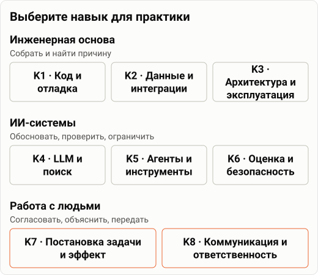
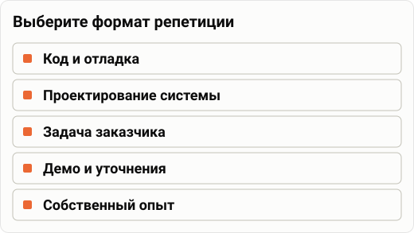
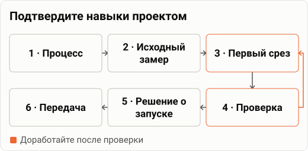

# Forward Deployed Engineer: от задачи заказчика до production

[English](../../careers/fde.md) · [Русский](fde.md) · [Профессии будущего](README.md) · [Карта атласа](../README.md)

**Forward Deployed Engineer (FDE)** — инженерная роль рядом с заказчиком, связывающая неясную рабочую задачу с пригодной к использованию технической системой. Название не объясняет долю кода, системного анализа, поездок или коммерческой ответственности. Начните с требований, затем проверьте себя на конкретной работе.

## <a id="role-requirements"></a>Что требуется от FDE

Перед вами четыре конкретных примера, а не универсальный чек-лист. Проверено **20 ноября 2026 года**. Последний столбец — наша рекомендация по подготовке, а не система оценки работодателя.

| Работодатель и точная роль | Требования описания | Что подготовить |
| --- | --- | --- |
| [OpenAI — FDE, SF](https://openai.com/careers/forward-deployed-engineer-%28fde%29-sf-san-francisco/) | 5+ лет инженерии или технического внедрения с заказчиками; production-код frontend/backend; внедрение LLM. Поездки до 50%. | Объяснить и отладить интеграцию; защитить решение о поставке. [K1](#k1), [K3](#k3), [K8](#k8) |
| [Anthropic — FDE, Munich](https://job-boards.greenhouse.io/anthropic/jobs/5391016008) | 8+ лет технической работы с заказчиками; Python, production LLM, агенты и evals; немецкий как родной, свободный английский. Поездки 25–50%; отраслевой опыт — плюс. | Показать проверенного агента и разбор ошибок; отдельно сверить языки и локацию. [K4](#k4)–[K6](#k6) |
| [LangChain — Deployed Architect, Professional Services](https://jobs.ashbyhq.com/LangChain/0a5dd30c-6da1-4095-bd96-b16f27eeb333) | Соседнее название: заказчики, production-инфраструктура, Kubernetes/IaC, агенты, оценка, Python или TypeScript. | Объяснить границы развёртывания и восстановление. [K3](#k3), [K5](#k5). Прочитана индексированная официальная страница; прямой запрос вернул JavaScript-оболочку. |
| [WMT — Системный аналитик AI/Data / FDE](https://dreamjob.ru/employers/107743/vakansii/138622411) | Архивное зеркало: 4+ года аналитики или близкой работы по внедрению; SQL, API, модели процессов и приёмка. Python — плюс. | Контракт API, SQL-проверки и обоснованная приёмка. [K2](#k2), [K7](#k7). [Российский пример и ограничения](#russia-wmt) |

Для своей вакансии заполните четыре колонки: **требование → что делать лично → чем уже можете подтвердить → что осталось неизвестным**. Отделяйте обязательное от желательного. Учебный проект показывает навык, но не заменяет стаж, владение языком или право на работу.

**Следующий шаг:** [навыки K1–K8](#skills) · [подготовка к интервью](#interview-prep) · [кейсы](#practice-cases) · [проекты](#projects).

## <a id="what-the-role-owns"></a>Три варианта ответственности

Эти редакционные маршруты помогают разобрать вакансию, а не переименовать её или предположить более низкую техническую планку.

| Маршрут | Что показать | Что спросить работодателя |
| --- | --- | --- |
| **Hands-on engineering** | Код, тесты, отладку, интеграцию и production-решения | Кто пишет и ревьюит production-код? Есть ли дежурства? Какой coding оценивают? |
| **Интеграция и системный анализ** | Модели данных, SQL, API-контракты, требования и приёмку | Что я реализую лично? Кто отвечает за качество данных? Программирование — основная обязанность или плюс? |
| **Техническое руководство внедрением** | Компромиссы, объём, зависимости, решения о запуске и передачу | Кто отвечает за архитектуру и код? Какая команда и полномочия? Есть ли план по выручке? |

Пресейл может концентрироваться на техническом соответствии до покупки; инженер основного продукта обычно улучшает общий продукт; FDE часто разбирается ещё и с локальными ограничениями заказчика. Границы различаются. Управленческий опыт не доказывает навыка production-разработки, а работающая демонстрация — ответственности за всю поставку.

Конкретный пример технического лидерства — [Staff FDE в Anthropic](https://job-boards.greenhouse.io/anthropic/jobs/5449229008): техническое направление работы с клиентом, архитектура нескольких потоков и самостоятельная реализация. Сильное программирование и опыт production-систем по-прежнему нужны. Это отдельная роль в США; требования к языку и стажу из Мюнхена на неё не переносятся.

## <a id="why-this-role-now"></a>Рыночный контекст

[Датированный рыночный срез](README.md#market) объясняет интерес к FDE. Рост названия должности не показывает, какой из маршрутов выше нужен конкретной команде. Сравнивайте соседнюю роль [Product Builder](product-builder.md) по обязанностям, а не по новизне названия.

## <a id="day-to-day"></a>Что FDE действительно делает

Личные рассказы помогают заметить вопросы, которые вакансия оставляет открытыми. Это непроверенные индивидуальные наблюдения, а не средняя рабочая неделя.

| Наблюдение и источник | Что неизвестно | Полезный вопрос работодателю |
| --- | --- | --- |
| Один [участник Reddit](https://www.reddit.com/r/cscareerquestions/comments/1x86xpc/comment/phg9zdt/) описывает встречи, архитектуру, POC, коннекторы и позднее квоту. | Инженерная ли целевая команда, пресейл или сочетание | Как измеряется успех и сколько времени уходит на разработку, а сколько — на поддержку продаж? |
| Другой [участник](https://www.reddit.com/r/cscareerquestions/comments/1x86xpc/comment/phdls6g/) описывает участие от архитектуры и интеграции до обучения и production. | Где заканчивается дальнейшее сопровождение | Кто отвечает за инциденты и передачу заказчику после запуска? |
| [Интервью First Round с практиками](https://review.firstround.com/so-you-want-to-hire-a-forward-deployed-engineer/) обсуждают превращение клиентских находок в улучшения продукта. | Есть ли у команды путь в продуктовый roadmap | Какое клиентское решение стало повторно используемой возможностью продукта? |

Даты публикации, где они известны, приведены в [реестре](sources.md); относительный возраст Reddit-поста не превращается в точную дату.

## <a id="russia-wmt"></a>Россия: один архивный пример WMT

[Копия Dream Job](https://dreamjob.ru/employers/107743/vakansii/138622411) помечена архивной и датирована 19 октября 2026 года; [копия Quick Offer](https://quick-offer.ru/job/sistemnyy-analitik-aidata-forward-deployed-engineer-fde-103906) — закрытой. Это зеркала одной роли, а не два независимых подтверждения или действующие возможности найма.

Описание объединяет процессы, SQL, REST/webhooks и приёмку до внедрения. Оно иллюстрирует вариант с акцентом на интеграцию, но не доказывает, что FDE в целом мало программирует. AI-оценки и предложенные вопросы Quick Offer принадлежат платформе: это не требования WMT и не отчёты о её интервью.

Для исторического русскоязычного контекста: [статья Habr об инженере внедрения AI](https://habr.com/ru/articles/964392/) опубликована **8 ноября 2025 года**. Это комментарий автора, а не современный обзор всего российского рынка или замена требованиям работодателя.

## <a id="compensation"></a>Зарплаты и офферы: что сравнивать

Это отдельные наблюдения, а не зарплатный ориентир рынка. Различайте base, bonus, equity и совокупную компенсацию TC; не сравнивайте разные валюты и периоды как одинаковые показатели. Проверено 20 ноября 2026 года.

| Свидетельство | Сумма и область применения | Чего оно не доказывает |
| --- | --- | --- |
| [Вакансия OpenAI SF](https://openai.com/careers/forward-deployed-engineer-%28fde%29-sf-san-francisco/) — диапазон работодателя | US$185–300 тыс. годового base; equity дополнительно | Конкретный оффер, стоимость equity или гарантированный бонус |
| [Личный рассказ об оффере на Reddit](https://www.reddit.com/r/Salary/comments/1vbawdb/29m_just_accepted_dream_job_as_a_fde_at_tier_1_ai/) — не проверен независимо | Автор сообщает US$552 тыс. TC за 2026 год, в том числе US$230 тыс. base и pre-IPO equity | Название работодателя, vesting, ликвидность и состоявшуюся выплату; компанию не угадываем |
| [WMT на Quick Offer](https://quick-offer.ru/job/sistemnyy-analitik-aidata-forward-deployed-engineer-fde-103906) — архивное зеркало | От 220 тыс. ₽; период и gross/net в полученном тексте не установлены | Текущий оффер или достоверную рыночную медиану; AI-анализ зарплаты платформы не используем |

До сравнения оффера уточните период, локацию, base, целевой или гарантированный бонус, инструмент equity, vesting и основание оценки. Расчётная стоимость доли до IPO не равна деньгам, доступным для расходов.

## <a id="skills"></a>Навыки K1–K8

Это редакционная карта подготовки, а не отраслевой стандарт или оценка вашей готовности. Откройте вопрос из строки, ответьте вслух, затем подготовьте указанный результат. У каждого вопроса сохраняется собственная метка источника.

<picture>
  <source media="(prefers-color-scheme: dark)" srcset="../../assets/fde-skills.ru.dark.svg">
  
</picture>

| Область | Что сделать и проверить | Вопрос для практики |
| --- | --- | --- |
| <a id="k1"></a>**K1 — Код, проверки и отладка** | Воспроизводимое изменение; объяснить код и найти сбой | [Отладка API-сервиса](../themes/coding-practical.md#code-debug-api-service) |
| <a id="k2"></a>**K2 — Данные и интеграции** | Контракт API и проверки данных; обработать дубли и пропуски | [Надёжные webhooks](../themes/ai-system-design.md#sd-webhooks) |
| <a id="k3"></a>**K3 — Проектирование и эксплуатация** | Границы сбоев, цели сервиса, стоимость и восстановление | [LLM gateway](../themes/ai-system-design.md#sd-gateway) |
| <a id="k4"></a>**K4 — LLM и поиск** | Отделить ошибки поиска от ошибок генерации | [Корпоративный поиск](../themes/ai-system-design.md#sd-enterprise-rag) |
| <a id="k5"></a>**K5 — Агенты и инструменты** | Обосновать автономность; выяснить неизвестный исход внешнего действия | [Повторы вызовов](../themes/agents-tools.md#agt-retries) |
| <a id="k6"></a>**K6 — Качество и безопасность** | Репрезентативные тесты, release gate, права и точное одобрение | [Допуск к выпуску](../themes/evals-observability.md#eval-release-gate) · [Одобрение](../themes/agents-tools.md#agt-approval) |
| <a id="k7"></a>**K7 — Задача и эффект** | Текущий процесс, исходные метрики и основание применять AI | [Discovery](../themes/applied-scenarios.md#app-claims-discovery) |
| <a id="k8"></a>**K8 — Коммуникация и ответственность** | Понятное решение, владельцы и передача | [Готовность к запуску](../themes/program-delivery.md#prog-multi-owner-readiness) |

Инженеру нужен работающий код. Специалисту по интеграциям — контракты, SQL и проверки приёмки. Руководителю внедрения — объяснение технических компромиссов и полномочий с точным указанием собственной инженерной работы. Всем троим нужно достаточно понимания, чтобы распознать сбой за пределами своей сильной области.

## <a id="interview-prep"></a>Интервью: свидетельства и тренировка

**[Подробные разборы ответов на FDE-вопросы](fde-forum-answers.md)** — 12 тем с кодом, объяснением решений, уточнениями и проверками. В [рассказах участников](fde-forum-reports.md) видно, какие части действительно описаны в источниках.

Порядок подготовки: уточнить процесс целевой команды, выбрать подходящие вопросы с источниками, провести пробное интервью, затем устранить проявившийся пробел. Требования к coding различаются; AI-инструменты и работа с заказчиком не отменяют инженерную базу.

<picture>
  <source media="(prefers-color-scheme: dark)" srcset="../../assets/fde-interviews.ru.dark.svg">
  
</picture>

| Происхождение | Конкретный материал | Как использовать |
| --- | --- | --- |
| **Рассказ интервьюера** | В [First Round](https://review.firstround.com/so-you-want-to-hire-a-forward-deployed-engineer/) бывшая руководительница найма FDE в Palantir описывает decomposition-сценарий об инсайдерской торговле. [Вопрос атласа](../themes/applied-scenarios.md#app-financial-crime-decomposition). | Объяснить нужные данные и вопросы заказчику. Историческое свидетельство со стороны найма, не современный универсальный loop. |
| **Рассказ кандидата** | [Отчёт Reddit о FDSE](https://www.reddit.com/r/csMajors/comments/1j99s3z/palantir_fdse_interview_experience_rejection/) описывает приложение для обмена интересами пользователей и следующую за ним функцию поиска. | Тренировать уточнение функциональности до рассуждений о масштабе. Один непроверенный рассказ не описывает интервью всех команд. |
| **Вторичное руководство †** | [Поиск по каталогу как инструмент модели](../themes/coding-practical.md#code-catalogue-search-tool) привязан к preparation guide на странице вопроса. | Решить задачу, сохранив вторичную метку. Не называть подтверждённым вопросом компании. |
| **Авторский mock** | Условный заказчик хочет «AI», но ещё не назвал процесс и не предоставил данные. | Провести разговор по сценарию ниже; без атрибуции работодателю. |
| **Авторская практика** | ERP-операция завершилась тайм-аутом после возможного изменения состояния. | Реализовать и проверить [кейс 2](#case-2); это не утечка задания интервью. |

**Пробное интервью на 25 минут:** 5 минут на пользователя, текущую задачу и ограничения; 10 на ограниченный пилот; 5 на возражения заказчика; 5 на обратную связь. Это наш учебный формат. Наблюдатель проверяет, спрашиваете ли вы до предложения решения, определяете ли измеримый результат, раскрываете ли допущения и согласуете ли владельца и следующий шаг. Повторите с новым ограничением: данные не могут покинуть среду заказчика.

Конкретные вопросы из рассказов участников — в разделе [FDE-интервью на форумах](fde-forum-reports.md): Reddit и LeetCode с датами, границами ролей и указанием недостающих подробностей. Больше этапов и вопросов с атрибуцией — в [обзоре роли FDE](../roles/fde.md). Материалы с NDA-ограничениями исключаются по [методике](../METHODOLOGY.md).

## <a id="practice-cases"></a>Тренировочные кейсы

**Авторские упражнения, а не вопросы из подтверждённых интервью.** Все числа и сроки ниже — вымышленные условия задачи. Разберите каждый кейс вслух, затем составьте записку с решением на одну страницу. У связанных вопросов атласа собственные источники; ссылка отсюда не доказывает, что их задаёт работодатель на FDE.

### Кейс 1 — Полезный помощник поддержки за две недели

**Условие.** Команда поддержки хочет помощника по 20 000 внутренних документов. Доступ зависит от команды, документы противоречат друг другу, времени на проверку ответов мало. Спонсор просит пилот за две недели.

**Задание.** Задайте пять вопросов для discovery, выберите один процесс, нарисуйте путь данных и предложите решение о пилоте. Укажите, что отложите.

**Сильный ответ включает:** текущую задачу и исходные затраты времени / частоту ошибок; проверку прав до передачи материалов модели; актуальность документов и ссылки на основания ответа; репрезентативный набор проверок с ответимыми, неответимыми и запрещёнными запросами; передачу человеку; владельца пилота. До смены модели разделите ошибки поиска и генерации.

**Вариант начала:** «Я выберу один процесс поддержки и вместе с операторами определю, что значит правильный и пригодный результат. До расширения доступа проверю права и измерю, сокращает ли помощник работу с учётом проверки и исправлений». Продолжите архитектурой и тестами; не выдавайте упражнение за свой прошлый опыт.

**Усложнение.** Демонстрация понравилась, спонсор хочет завтра открыть доступ всей компании. Назовите недостающие доказательства и предложите минимальный безопасный следующий шаг.

По теме: [корпоративный поиск](../themes/ai-system-design.md#sd-enterprise-rag), [пилот с ограничениями](../themes/applied-scenarios.md#app-vpc-pilot), [ошибки retrieval](../themes/applied-scenarios.md#app-rag-account-triage).

<a id="case-2"></a>

### Кейс 2 — Агент получил тайм-аут после создания заявки

**Условие.** Помощник создаёт рабочие заявки в ERP. Запрос завершается тайм-аутом, оператор повторяет его, появляются две заявки. Заказчик просит исправить промпт модели.

**Задание.** Объясните сбой, спроектируйте восстановление и определите, что именно подтверждает человек.

```text
Черновик → Проверка данных и прав → Одобрение точного действия → Выполнение
                                                                    ↓
                                      Запись результата / сверка после тайм-аута
                                                                    ↓
                                         Повтор только после выяснения состояния
```

**Сильный ответ включает:** различие неизвестного исхода и невыполненной операции; стабильный идентификатор операции и дедупликацию на стороне ERP, если она доступна; сверку состояния, если нет; привязку одобрения к точным аргументам и действующим правам; аудит; компенсацию или эскалацию необратимых действий. Исполнитель обеспечивает эти ограничения независимо от инструкций модели.

**Усложнение.** В ERP нет API идемпотентности. Опишите поиск и сверку результата, оставшуюся гонку. Объясните, когда останавливаете автоматизацию и передаёте решение оператору вместо обещания exactly-once.

По теме: [запись в ERP](../themes/agents-tools.md#agt-erp-writes), [тайм-ауты и повторы](../themes/agents-tools.md#agt-retries), [привязка одобрения](../themes/agents-tools.md#agt-approval).

### Кейс 3 — Пилот прошёл тест, но им не пользуются

**Условие.** Пилот правильно отвечает на 90% небольшого тестового набора. Еженедельное использование падает, результаты приходится копировать в другую систему. Спонсор ждёт решения о масштабировании через пять дней.

**Задание.** Разделите качество, пригодность для рабочего процесса и использование; предложите исследование и решение с владельцем.

**Сильный ответ включает:** способ отбора тестов и скрытые ошибки; наблюдение за реальной работой; полное время задачи с проверкой и повторным вводом; неудобства интеграции; сегменты пользователей; стоимость завершённой полезной задачи; условия продолжения, сужения или остановки. Использование не равно пользе, а результат теста не равен готовности к production.

**Усложнение.** Одна команда довольна, другая отказывается от инструмента. Разделите данные по сегментам, не скрывая различие средним значением.

По теме: [спасение пилота](../themes/applied-scenarios.md#app-pilot-rescue), [уместность AI](../themes/ai-product-strategy.md#prod-ai-suitability), [метрики AI-функции](../themes/ai-product-strategy.md#prod-ai-feature-metrics).

## Как оценить ответ

Эта авторская шкала выявляет пробелы подготовки, а не предсказывает найм. Оцените каждое измерение: **0** — отсутствует, **1** — упомянуто, **2** — связано с конкретным решением, артефактом и компромиссом.

| Измерение | Что делает ответ проверяемым |
| --- | --- |
| Discovery | Задача пользователя, исходные метрики, ограничения и владелец результата |
| Инженерия | Путь данных, границы доверия, интеграции и восстановление |
| Оценка качества | Репрезентативные проверки, разбор ошибок и обоснованный допуск к запуску |
| Поставка | Объём, зависимости, поэтапный доступ, откат и передача |
| Коммуникация | Ясные допущения; объяснение решений оператору и спонсору |

Повторите измерения ниже 2. Высокая сумма не компенсирует отсутствие прав доступа или неконтролируемую запись во внешние системы. Инженерам стоит реализовать и проверить узкий срез; руководителям — объяснить архитектуру, поставку и ответственность, точно обозначая личный вклад.

## <a id="projects"></a>Проекты с критериями готовности

Используйте синтетические данные или публичные материалы с подходящей лицензией. Это авторские учебные проекты, а не домашние задания работодателей. Помечайте условные метрики: учебный результат нельзя выдавать за реальный эффект у заказчика.

| Проект | Результаты работы | Какой сбой показать | Проверка завершения |
| --- | --- | --- | --- |
| **P1 — Помощник по документам для одной задачи** | Brief, матрица доступа, небольшой корпус, тестовый набор, запускаемое демо | Запрет доступа, отсутствие основания ответа, устаревший документ | Другой человек повторяет запуск; права соблюдаются; ошибки поиска и генерации разделены. K2, K4, K6, K7 |
| **P2 — Агент заявок с API-заглушкой** | Контракт, состояние операции, запись одобрения, тесты | Тайм-аут после записи, дубль, истёкшее одобрение | Система обнаруживает неизвестный исход и сверяет его; повтор не создаёт неконтролируемый дубль. K1, K2, K5, K6 |
| **P3 — Пилот, который можно эксплуатировать** | Исходные метрики, решение о запуске, runbook, владельцы, срезы использования | Хорошее среднее качество скрывает провал группы пользователей | Рецензент связывает решение продолжить/сузить/остановить с данными и видит владельца сопровождения. K3, K7, K8 |

### <a id="delivery-cycle"></a>Соедините работу в итоговом проекте

<picture>
  <source media="(prefers-color-scheme: dark)" srcset="../../assets/fde-project.ru.dark.svg">
  
</picture>

| Этап | Артефакт | Переход к практике |
| --- | --- | --- |
| Discovery | Процесс, исходные метрики и приёмка | [Первые две недели с заказчиком](../themes/applied-scenarios.md#app-claims-discovery) |
| Узкая сквозная интеграция | Один рабочий путь через данные, API и права | [Записи в ERP](../themes/agents-tools.md#agt-erp-writes) |
| Качество и выпуск | Ошибки и обоснованный допуск к запуску | [Release gate](../themes/evals-observability.md#eval-release-gate) |
| Эксплуатация и передача | Наблюдение, восстановление и владелец | [Готовность разных команд](../themes/program-delivery.md#prog-multi-owner-readiness) |
| Внедрение и переиспользование | Полезный результат задачи и повторно используемое улучшение | [Метрики функции](../themes/ai-product-strategy.md#prod-ai-feature-metrics) |

Представьте короткую демонстрацию, один сложный сбой и одно решение, изменённое после проверки. Для руководящего маршрута добавьте записку с решением и распределение ответственности; укажите, кто реализовал каждый компонент. Презентация или демо без проверки сбоев не завершают упражнение.

## <a id="two-week-preparation-plan"></a>Двухнедельный план подготовки

| Занятия | Работа | Подтверждение результата |
| --- | --- | --- |
| 1–2 | Сравнить две вакансии; выбрать слабую K-область | Матрица требований и три вопроса рекрутеру |
| 3–4 | Кейс 1; K2, K4, K6, K7 | Процесс, архитектура и таблица оценки |
| 5–6 | Собрать P1; объяснить код (K1) | Воспроизводимый запуск, ошибки и ограничения |
| 7–8 | Кейс 2 / P2; K1, K2, K5, K6 | Тесты восстановления и чек-лист одобрения |
| 9–10 | Кейс 3 / P3; K3, K7, K8 | Решение, владелец, условия остановки и передача |
| 11–14 | Два mock-интервью; повторить неудачную проверку | Вторая попытка и доказательства изменений |

Подготовьте по одному правдивому примеру неопределённости, сложного сбоя и передачи результата. Отделяйте личные решения от достижений команды. Если пример учебный, так и скажите.

## <a id="sources-and-limits"></a>Учебные ресурсы и ограничения источников

- [Anthropic Partner Academy: Claude FDE](https://anthropic-partners.skilljar.com/path/claude-fde): публичный план включает 11 курсов общей длительностью около 9,5 часа; девять пересекаются с Claude Developer, ещё два посвящены методике поставки и внедрению Claude в организации. Один из результатов — письменный план пилота: исходные метрики, меры успеха до начала разработки, первый поставляемый срез и первая группа пользователей. Это описание обучения, не интервью; условия доступа уточняйте на сайте. Дата публикации не указана, проверено 19 ноября 2026 года.
- [Вакансия OpenAI FDE](https://openai.com/careers/forward-deployed-engineer-%28fde%29-sf-san-francisco/): подтверждает обязанности выше, но не формат coding-раунда и не вопросы интервью.
- [Отчёт Ленни за конец 2026 года](https://www.lennysnewsletter.com/p/state-of-the-tech-job-market-late): основание датированного рыночного сигнала. Использован только публично доступный фрагмент.
- Продолжайте с [обзора FDE с источниками](../roles/fde.md), [учебного плана](../LEARNING_PATH.md), стартовых страниц [инженера](../start/engineering.md) и [руководителя](../start/leadership.md). Фактический формат интервью уточняйте у работодателя.

В [реестре карьерных источников](sources.md) разделены описания работодателей, рассказы практиков, зарплатные свидетельства и авторские упражнения; указаны даты и ограничения доступа.
